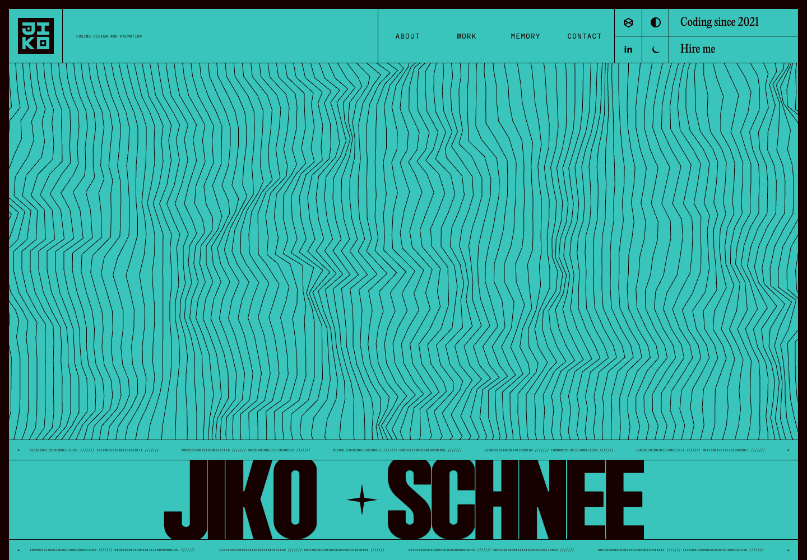

# Awesome Portfolio

Jiko Schnee's interactive portfolio, featuring theme switching, an introduction, education, selected impact, project videos, and a contact section.

## Live site

[Open Awesome Portfolio](https://jikoschnee.github.io/Awesome-Portfolio/)

## Reference preview

Screenshot of this project's homepage. Motion and interactive effects are available on the live site.



## Featured work

- Delta Harmonica Macro — product ownership, development, community, and growth.
- Class Echo — live classroom interpretation for international students.

## Local preview

```sh
python3 -m http.server 8000
```

Open `http://localhost:8000/`. No installation or build step is required.

## Deployment

GitHub Actions publishes the repository to GitHub Pages after each push to `main`. The workflow can also be run manually.

## Design references

The original visual direction is inspired by [Antoine Wodniack's portfolio](https://wodniack.dev/). The project retains reference media under `assets/wodniack/`; those assets belong to their respective owners. Portfolio content and selected projects have been personalized for Jiko Schnee.
